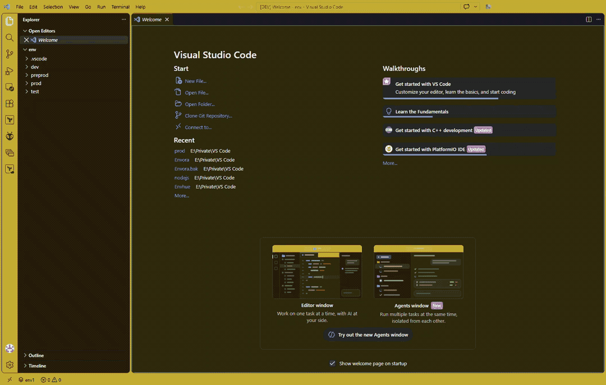

# Envhue

**Never mistake PROD for DEV again.**

<p align="center">
  
</p>

Envhue colors and protects your VS Code windows by environment (DEV, TEST, PREPROD, PROD): a colored window, a `[PROD]` title prefix, a confirmation before opening, and an optional read-only mode. It works with local folders, Remote SSH, WSL and Dev Containers.

You can also switch between your local folders, Remote SSH, WSL and Dev Container targets from one picker, and gives each environment its own identity: colored title bar, activity bar and status bar, a `[PROD]` prefix in the window title, and an optional confirmation before opening sensitive environments.

It combines the idea of a project switcher with workspace coloring, built around the DEV / TEST / PREPROD / PROD workflow.

## Features

- **Side panel** (click the Envhue icon in the activity bar): see and change the settings of the environment you are in (name, client, type, colors, confirmation, read-only by default, session lock, favorite, location), and open any other environment in one click. Buttons at the top add, import or manage environments.
- **Editing keeps your values**: when you edit an environment, the current folder, host, distribution, type, confirmation and read-only choices are offered first (or pre-filled), so you only change what you need.
- **Local, SSH, WSL and Dev Container environments** in the same picker. WSL distributions are listed for you on Windows; a Dev Container environment is a local folder that Envhue reopens in its container.
- **Import from Project Manager and Peacock** (`Envhue: Import from Project Manager and Peacock`): pick projects from your Project Manager list, including its SSH, WSL and Dev Container entries. The accent color Peacock saved in each project's `.vscode/settings.json` is reused; the type (DEV, TEST, PREPROD, PROD) is guessed from the name and tags and can be reviewed afterwards.
- **Production detection**: when you add an environment, the type is suggested from the name, SSH host, WSL distribution and the last two folders (whole words only: `prod`, `production`, `preprod`, `staging`, `qa`, `dev`…). A folder that is open but not registered and looks like production triggers an offer to register it as PROD, with or without read-only. Dismiss it per folder, or turn it off with `envhue.detectProduction`.
- **Optional read-only mode** (recommended for PROD, never forced): files are locked in the editor and Explorer, a `$(lock) READ-ONLY` item stays in the status bar and the window title shows `[PROD · READ-ONLY]`. You can unlock it for the session in one click and lock it again.
- **SSH host autocompletion**: when adding a Remote SSH environment, pick the host from your `~/.ssh/config` (or the file set in `remote.SSH.configFile`), with its user and address shown. `Include` files are followed; wildcard patterns are skipped; manual entry is always available.
- **One picker** for local and Remote SSH environments (`Envhue: Select Environment`, or click the status bar item).
- **Instant recognition**: title bar, activity bar and status bar use the environment's accent color; editor, side bar, panel and terminal backgrounds are tinted. Text is black or white automatically, for readable contrast.
- **Window title prefix** such as `[PROD]`, also visible in the taskbar, and usable without relying on color alone.
- **Confirmation before opening** sensitive environments (always on for PROD).
- **Colors applied automatically** whenever a registered folder is open, however you opened it (picker, recent list, shortcut).
- **Non-destructive**: your other `workbench.colorCustomizations` (including per-theme blocks) are preserved, and `Envhue: Reset Colors and Read-Only Lock` removes only what Envhue wrote.
- **Favorites, client grouping** (the `client` field) and an optional list of recommended extensions per environment.
- **No telemetry and no account.**
- **Free edition: up to 4 environments**, enough for DEV, TEST, PREPROD and PROD of one client. Existing environments are never removed or locked.

## Getting started

1. Run **Envhue: Add Environment** from the Command Palette.
2. Pick a name, a folder (local or SSH), a type and an accent color. The other colors are derived automatically; you can also customize them.
3. Run **Envhue: Select Environment** to open it. From then on, its colors are applied every time that folder is open.

For SSH environments, install the official **Remote - SSH** extension. `server` must be a host or alias known to it (for example an entry of your `~/.ssh/config`). Envhue runs as a UI extension and does not need to be installed on the remote host.

For WSL environments, install the **WSL** extension (or **Remote Development**); for Dev Container environments, the **Dev Containers** extension. A Dev Container environment points at the local folder that holds the `.devcontainer` configuration. Envhue opens it, then asks the Dev Containers extension to reopen it in the container.

## Free and Pro

The core is free: environments (local, SSH, WSL, Dev Container), colors, window title, confirmation, read-only mode, production detection, import, side panel. The Free edition holds up to four environments.

Pro modules are unlocked with a license key (`Envhue: Enter License Key`). Today they are: unlimited environments; temporary unlock (the lock comes back by itself after a duration you choose); the picker grouped by client; and a terminal alert (a warning when a command that looks like it changes things runs in a locked environment — read-only mode does not cover the terminal, and the alert cannot stop the command; it needs VS Code 1.93+ with shell integration). License keys are not on sale yet. Without a key, or when a key expires, Envhue keeps working as the Free edition and your environments are never removed.

## Commands

| Command | Description |
|---|---|
| `Envhue: Select Environment` | Pick and open a configured environment |
| `Envhue: Manage Environments` | Add, edit or delete environments |
| `Envhue: Import from Project Manager and Peacock` | Select projects from Project Manager and register them as environments |
| `Envhue: Edit Current Environment` | Edit every setting of the environment you are in, starting from its current values |
| `Envhue: Add Environment` | Start the environment creation flow |
| `Envhue: Show Current Environment` | Display the active workspace identity |
| `Envhue: Change Colors of the Current Environment` | Pick a new accent color (presets or hexadecimal) and apply it immediately. Also available from the status bar item |
| `Envhue: Apply Colors to This Workspace` | Re-apply the colors of the current environment |
| `Envhue: Show License and Plan` | See your plan, enter or remove a license key |
| `Envhue: Enter License Key` | Activate a Pro key |
| `Envhue: Toggle Read-Only Mode` | Lock or unlock the current environment for this session. Also available from the status bar item |
| `Envhue: Reset Colors in All Environments` | Remove what Envhue wrote from every registered folder. Run it **before uninstalling** the extension |
| `Envhue: Reset Colors and Read-Only Lock` | Remove the colors, title and read-only lock written by Envhue |

## Settings

| Setting | Default | Description |
|---|---|---|
| `envhue.environments` | `[]` | Your environments (see below) |
| `envhue.autoApplyColors` | `true` | Apply colors whenever a registered folder is open |
| `envhue.tintBackgrounds` | `true` | Also tint editor, side bar, panel and terminal. Turn off to color only the bars (recommended with light themes) |
| `envhue.windowTitlePrefix` | `true` | Prefix the window title with the environment type |
| `envhue.detectProduction` | `true` | Offer to register unregistered folders that look like production |
| `envhue.terminalAlert` | `true` | Pro. Warn about commands that look like they change things in a locked environment's terminal |
| `envhue.openRemoteInNewWindow` | `true` | Open SSH, WSL and Dev Container environments in a new window, so a failed connection never replaces your current window |
| `envhue.openInNewWindow` | `false` | Open the selected environment in a new window |
| `envhue.showOnStartup` | `false` | Show the picker when VS Code starts |

Environments live in your user settings, so **Settings Sync carries them across your machines**.

## Environment configuration

Only `name` and `path` are required. Colors are derived from `accent` when omitted.

```json
{
  "name": "Client A - DEV",
  "client": "Client A",
  "type": "DEV",
  "connection": "local",
  "path": "C:/work/client-a",
  "colors": { "accent": "#287A45" },
  "favorite": true
}
```

```json
{
  "name": "Client A - PROD",
  "client": "Client A",
  "type": "PROD",
  "connection": "ssh",
  "server": "production-host",
  "path": "/srv/client-a",
  "colors": { "accent": "#C33D3D" },
  "requireConfirmation": true
}
```

```json
{ "name": "Client A - WSL", "type": "DEV", "connection": "wsl", "distro": "Ubuntu", "path": "/home/me/client-a" }
```

```json
{ "name": "Client A - Container", "type": "TEST", "connection": "devcontainer", "path": "C:/work/client-a" }
```

Add `"readOnly": true` to any environment to open it read-only.

All four colors can be set explicitly: `accent`, `background`, `sidebar` and `text` (the text drawn on the accent color).

Do not store passwords, private keys or tokens in environment definitions.

## Good to know

- Colors are written to the **workspace settings** of the opened folder (`.vscode/settings.json`). If you do not want them in a shared repository, add `.vscode/settings.json` to your `.gitignore` or global ignore, or turn `envhue.autoApplyColors` off and use `Envhue: Apply Colors to This Workspace` when needed.
- **Read-only is a guard rail, not a security boundary.** It uses VS Code's `files.readonlyInclude` setting, so it locks the editor and the Explorer only. Terminal commands, tasks and extensions can still modify files. It is applied from the workspace settings and removed when you unlock. The lock is reapplied each time the environment is opened; unlocking lasts for the current window session only. `.vscode/**` and `*.code-workspace` stay writable so the lock can always be lifted.
- **Uninstalling:** VS Code does not let an extension clean up when it is removed, so the colors stay in your workspaces' `.vscode/settings.json`. Run `Envhue: Reset Colors in All Environments` first. It cleans local and Dev Container folders; remote folders and `settings.json` files that contain comments are listed so you can reset them from their own window (Envhue never rewrites a file with comments).
- Production detection is a hint based on words, not a guarantee. A production server without "prod" in its name will not be flagged.
- Confirmation prompts are safety reminders, not access controls. Envhue does not check that a remote path is really production: the type is what you configure.
- The recommended-extensions option installs extensions **globally** in VS Code, not only for one environment. VS Code does not let an extension switch profiles; the profile option only reminds you and opens the profile switcher.
- Coming from the PowerShell launcher? The old format (`Nom`, `Dossier`, `Serveur`, `Accent`, `Fond`, `Lateral`, `Texte`, `Confirmer`) is still understood.

## Roadmap

- [x] Local and Remote SSH environments
- [x] Automatic, non-destructive colors and window title
- [x] Unit tests for the pure logic
- [x] Host autocompletion from `~/.ssh/config`
- [x] WSL and Dev Containers
- [x] Read-only mode for PROD (opt-in)
- [x] Import from Project Manager and Peacock

## License

MIT. See the LICENSE file.
